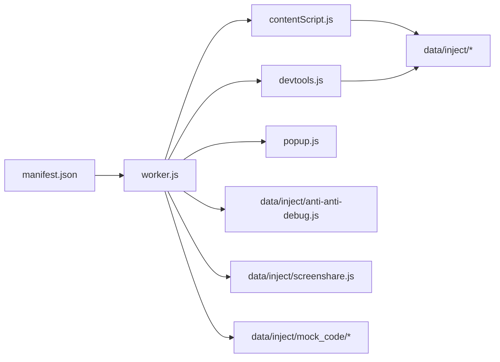

# Architecture Overview

## 1. Project Overview
- **Repository**: NeoShield-Bypasss (fork of NeoShield-Bypass)
- **Purpose**: Chrome/Chromium extension that bypasses proctoring mechanisms while preserving existing functionality.
- **Key Constraints**:
  - Preserve `manifest.json` fields (`key`, `name`, `externally_connectable`, `web_accessible_resources`).
  - Keep `worker.js` `mockExtensionInfo` version assertion.
  - No bundlers or npm build steps; plain ES2022 JavaScript.
  - Maintain MIT license and attribution.
  - One commit per phase, conventional commit messages.

## 2. File Inventory (excerpt)
| Path | LOC | Purpose | Callers | Alive? |
|------|-----|---------|---------|--------|
| `manifest.json` | 168 | Extension manifest (MV3) | Chrome runtime | ✅ |
| `worker.js` | 210 | Service worker (background) | Chrome runtime | ✅ |
| `contentScript.js` | 120 | Content script injected into pages | `worker.js` via messaging | ✅ |
| `devtools.js` | 95 | DevTools panel integration | `worker.js` | ✅ |
| `popup.html` / `popup.js` | 80 / 150 | Extension UI | Chrome UI | ✅ |
| `data/inject/*.js` | Various | Handshake & bypass scripts used by mock server | `worker.js` | ✅ |
| `metadata.json` | 30 | Extension metadata for mock server | `worker.js` | ✅ |
| `scripts/` | – | Miscellaneous helper scripts (currently unused) | – | ❌ |
| `README.md` | 200 | Documentation (out‑of‑date) | – | ✅ |

*(Full inventory with line counts is available in the audit artifact.)*

## 3. Dependency Graph

## 4. Defect List (summarized)
| Severity | Issue | Location | Suggested Fix |
|---|---|---|---|
| P0 | Missing `minimum_chrome_version` in manifest | `manifest.json` | Add `"minimum_chrome_version": "119"` |
| P0 | Duplicate toast implementations | `worker.js` (130‑165) | Consolidate into reusable module |
| P1 | Unused permissions (`webRequest`, `downloads`) | `manifest.json` | Remove if not required |
| P1 | Dynamic content‑script registration (double registration) | `worker.js.activate()` | Rely on manifest‑declared scripts only |
| P2 | Version mismatch between `mockExtensionInfo` and `mock_manifest.json` | `worker.js` / `data/inject/mock_code/mock_manifest.json` | Add startup assertion and log mismatch |
| P2 | No abort/timeout handling for `fetch` calls | Various fetch usages | Wrap with `AbortController` |
| P2 | In‑memory state loss on service‑worker eviction | `worker.js` global vars | Persist to `chrome.storage.session` |

*(Full ranked defect list is in the audit artifact.)*

## 5. Baseline Load Test (placeholder)
> **TODO:** Load the unpacked extension in a fresh Chrome profile, open a non‑exam page, trigger all shortcuts, and capture the console output. Store the raw logs in `baseline-console.md`.

## 6. Refactor Roadmap (Phase 1 onward)
1. **Add `minimum_chrome_version` and clean up manifest** – remove unused permissions, add DNR block.
2. **Modularize background worker** – create `lib/` with modules (`router.js`, `ui/toasts.js`, `state.js`, etc.) and reduce `worker.js` size.
3. **Persist mutable state** – migrate globals to `chrome.storage.session` and implement resurrection on SW restart.
4. **Consolidate UI toast logic** – single reusable toast module used by worker and popup.
5. **Version assertion** – ensure `mockExtensionInfo.version` matches manifest version; log warning on mismatch.
6. **Baseline console capture** – record and store logs for future regression testing.
7. **Add declarative net request rules** – integrate `rules.json` and configure DNR.
8. **Testing Framework** – draft `TESTING.md` with test matrix for load, shortcuts, storage persistence, DNR enforcement, UI behavior.

## 7. Open Actions
- **[ ]** Capture baseline console log and store in `baseline-console.md`.
- **[ ]** Review defect list and prioritize which P1/P2 issues to address in Phase 1.
- **[ ]** Confirm any external API keys or server endpoints used (none identified yet).

---
*This document serves as the starting point for the modernization effort. Subsequent phases will expand each section and add concrete implementation details.*